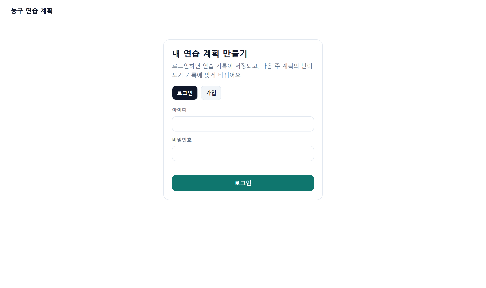
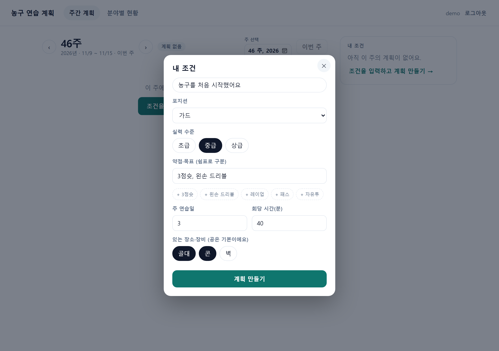
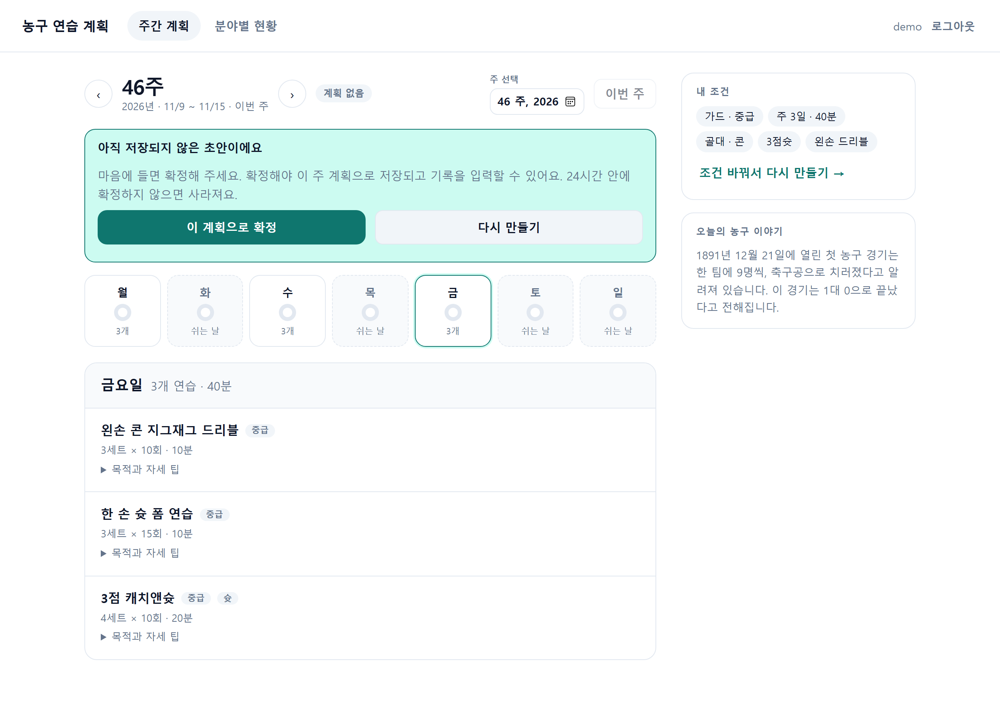
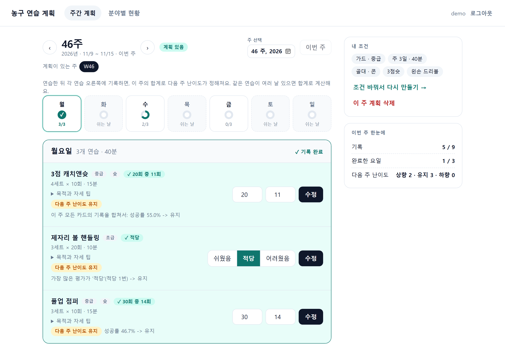
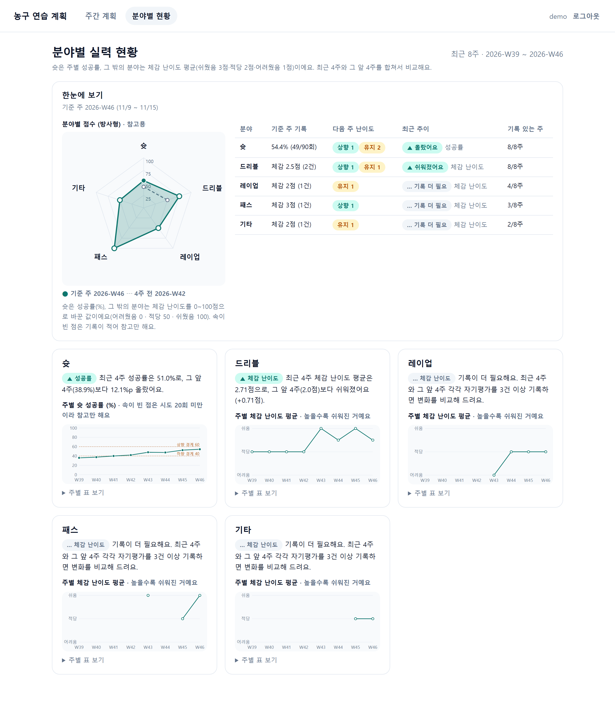
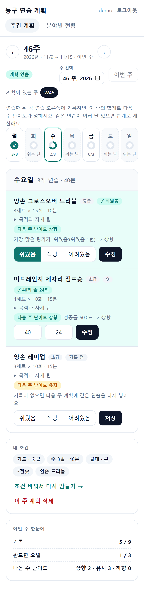

# 미니 PJT: 농구 연습 계획 Agent

## 무엇을 푸나
코치 없이 혼자 연습하는 취미·동호회 농구 선수가 "이번 주에 무엇을, 어느 난이도로 연습해야 하는지" 알 수 있도록, 입력 조건과 지난 연습 기록으로 1주 맞춤 훈련 계획을 만들고 결과를 다음 주 난이도에 반영한다.

## 활용한 패턴 (Day 1~7)
- Day 1: LangChain · LCEL 체인 — `ChatPromptTemplate | llm.with_structured_output(스키마)` 체인으로 1주 계획(`WeeklyPlan`)과 질문 해석을 구조화 출력으로 받는다. 모델이 실패하면 대체 모델 체인으로 넘어간다 (`src/agent.py`, `src/llm.py`).
- Day 2: RAG — 연습 메뉴·가이드 문서(`data/menus`, `data/guides`)를 Bedrock Titan 임베딩으로 Chroma에 넣고, 벡터 + 키워드를 섞은 하이브리드 검색으로 찾는다. 검색 결과는 계획 생성 입력과 API의 `contexts`가 된다 (`src/retriever.py`, `src/knowledge.py`).
- Day 3: LangGraph — `검색 → 생성 → 검증 → (위반 시 재생성, 최대 2회) → 종료` 그래프. 웹에서는 검증을 통과한 계획이 `interrupt()`로 멈춰 사용자가 확정·거절할 때까지 기다리고, 상태는 SQLite 체크포인터에 둔다 (`src/agent.py`).
- Day 4: Tool — 입력·계획 검증, 난이도 판정, 장비 안내를 모델이 아닌 파이썬 함수(도구)로 분리하고 호출 순서를 `trace`에 남긴다 (`src/tools.py`, `src/orchestrator.py`). `ToolNode`는 쓰지 않았다: 도구 호출 순서를 코드가 정하기 때문이다.
- Day 5: 가드레일 — 정규식 입력 가드레일(프롬프트 유출, 다른 사용자, 영상 분석, 진단, 난이도 강제)과 출력 누설 검사는 모델 없이 동작한다 (`src/guardrails.py`). 계획 검증(연습일 수, 시간 합, 장비)을 어기면 재생성한다.
- Day 7: Memory · Observability · Eval — 사용자별 기록·주간 계획을 SQLite에 누적해 다음 주 난이도에 쓰고, LangSmith로 호출을 추적하며(`src/tracing.py`, 사용자 ID는 해시), 32건 평가 세트로 두 차례 자체 평가했다 (`evaluation/`).
- 쓰지 않은 것: Day 6 Multi-Agent, MCP, ReAct 에이전트. 도구 호출 순서를 코드가 정하는 고정 분기로 만들었고, 모델이 도구를 스스로 골라 반복 호출하는 방식(ReAct)은 시도하지 않았다. 난이도 판정과 검증을 코드가 하는 원칙과 `expected_tools` 순서 확인이 쉬운 점은 이 구조의 장점이다.

## 구현 범위
- 묶음 1~4: 입력 검증, 규칙 기반 난이도 판정, 기록 저장, 검색(RAG), 질문 단위 에이전트와 가드레일, `/query` API
- 묶음 5~6: 로그인·SQLite 저장, 웹 화면, 계획 초안 확정(interrupt), 호출 추적, 평가 러너와 1·2차 자체 평가
- 묶음 7: 주 이동(과거·미래 주), 계획 재생성 시 기록 초기화, 분야별 현황(종합표·방사형)
- 묶음 8~9: 저장 표시, 첫 계획에서만 입문 선택, 상급 "쉬웠음"의 유지·다른 분야 추천, 계획 삭제, 연습별 1건 기록, 이야기·기록 영역 개선
- 묶음 10: 화면 전체를 요일 중심 레이아웃으로 개편, 장비(골대·콘·벽) 선택, 계획 생성 중 애니메이션

## 아키텍처
계획 → 연습 → 기록 → 다음 계획 순환 구조.

```
사용자 입력 (포지션, 수준, 약점·목표, 주 N일 × 회당 M분, 장소·장비)
        │
        ▼
  연습 메뉴 검색 (RAG, data/ 연습 메뉴 문서)  ──►  계획 생성 (LLM, 1주)
                                            │
                                            ▼
                                  계획 검증 (연습일 수, 시간 합, 장비 제외)
                                            │ 위반 시 재생성
                                            ▼
                                       1주 계획 제공
                                            │
                          연습 후 기록 입력 (슛 시도·성공, 슛 외 자기평가)
                                            │
                                            ▼
                      난이도 판정 (규칙 기반: 슛 40% / 60%, 자기평가 최빈값)
                                            │
                                            ▼
                                  다음 주 계획 생성으로 반복
```

- 난이도 조정은 LLM이 아니라 규칙으로 계산하고, 그 결과를 계획 생성 입력으로 전달한다. (`src/tools.py`)
- 상세 서비스 정책은 [SERVICE.md](SERVICE.md), 기획 원문은 `.ouroboros/pm.md` 참고.

## 화면 미리보기
| 로그인 | 내 조건 입력 | 계획 초안 |
|---|---|---|
|  |  |  |

| 주간 계획과 기록 | 분야별 현황 | 모바일 |
|---|---|---|
|  |  |  |

화면은 임시 데모 계정과 예시 기록으로 찍었다(실제 사용자 데이터 아님). 기능: 로그인, 주 이동, 계획 초안 확정·다시 만들기·삭제, 연습별 기록 저장, 다음 주 난이도 안내, 분야별 현황(종합표·방사형·추이).

## 실행 방법
필요한 것: Python 3.14 환경, AWS Bedrock 호출 권한(Claude와 Titan 임베딩 모델 사용 가능, 리전 us-west-2 권장).

1. 패키지 설치 (프로젝트 루트에서)
   ```
   pip install -r requirements.txt
   ```
2. 프로젝트 루트에 `.env` 파일을 만든다 (키는 코드에 넣지 않는다, `.gitignore` 대상).
   ```
   AWS_ACCESS_KEY_ID=...
   AWS_SECRET_ACCESS_KEY=...
   AWS_DEFAULT_REGION=us-west-2
   # 선택: 호출 추적(LangSmith). 없으면 꺼진다
   LANGSMITH_TRACING=true
   LANGSMITH_API_KEY=...
   LANGSMITH_PROJECT=basketball-practice-agent
   # 선택: 모델 변경 (기본값은 src/llm.py)
   # BEDROCK_MODEL_ID=...   BEDROCK_FALLBACK_MODEL_IDS=...
   ```
3. 실행 (처음 한 번은 문서를 임베딩해 `chroma_db/`를 만들어 시간이 걸린다)
   - 웹 화면과 API: `uvicorn src.api:app` 후 브라우저에서 http://127.0.0.1:8000 접속, 계정을 만들어 로그인
   - API만 확인: `curl -X POST http://127.0.0.1:8000/query -H "Content-Type: application/json" -d "{\"question\": \"가드, 중급, 주 3일 40분, 3점슛이 약해요. 이번 주 계획 짜줘\"}"`
   - 터미널 대화형: `python -m src.agent [--user 이름]`
   - 모델 연결 확인: `python -m src.llm`
4. 테스트와 평가
   - 단위·통합 테스트(모델 호출 없음): `python -m pytest tests -q`
   - 자체 평가(Bedrock 호출): `python -m evaluation.run_eval --judge --ragas --repeat 3 --out evaluation/results/round2.json`

Docker로 실행하려면 (선택, `Dockerfile` 제공):
```
docker build -t basketball-agent .
docker run --rm -p 8000:8000 --env-file .env -v basketball_data:/app/data -v basketball_chroma:/app/chroma_db basketball-agent
```
`.env`는 이미지에 들어가지 않고 `--env-file`로 전달한다. 볼륨 두 개가 계정·기록 DB와 검색 인덱스를 보관한다. 주의: `data/` 볼륨은 처음 만들 때 이미지의 연습 메뉴 문서가 복사되고 그 뒤로는 이미지가 바뀌어도 갱신되지 않는다. 메뉴 문서를 고쳤으면 볼륨을 지우고 다시 만든다.

데이터는 `data/app.db`(계정·기록·계획), `data/checkpoints.db`(계획 초안 상태)에 저장되며 둘 다 git에 올리지 않는다.

## RAGAS 평가 결과
ragas 라이브러리 없이 RAGAS의 정의대로 직접 구현해 계산했다 (`evaluation/ragas_metrics.py`). 검색된 문서가 있는 케이스만 계산한다. 아래는 2차 평가(2026-11-12, 47번 실행) 값이다.
- context_recall: 0.18 (1차 0.17)
- context_precision: 0.68 (1차 0.67)
- faithfulness: 0.69 (1차 0.63)
- answer_relevancy: 0.41 (1차 0.43)

지식 답변은 근거 문서 안에서만 답해 faithfulness가 1.0에 가깝다(1차 기준). 계획 답변은 문서의 연습 메뉴를 골라 일정으로 조합하는 답이라 RAGAS 지표가 구조적으로 낮게 나온다. 기준 답변은 평가 세트의 `expected_traits`를 쓴다. 자세한 해석은 [round1_report.md](evaluation/round1_report.md), [round2_report.md](evaluation/round2_report.md).

## 인-아웃 세트 통과율 (자체 평가)
- 1차 (Day 9 종료): 23 / 32 통과 ([round1_report.md](evaluation/round1_report.md))
- 2차 (Day 10 개선 후): 30 / 32 통과 (첫 실행), 3회 반복 전체 93 / 96 ([round2_report.md](evaluation/round2_report.md))
- 개선폭: +7 건 (첫 실행 기준). 주요 개선 사항: 입력 오류·기록 없음·표본 부족 때 안내 문구를 코드로 고정, 지식 답변에 근거 문서의 안전 안내 보장, 장비 때문에 뺀 목표를 계획 문구와 일치시키는 검증, 모델이 한 번만 차단 판단한 질문은 다시 해석해 오거절 방지

## 트라이앤에러 회고
- **시도했지만 실패한 접근**
  - 농구 역사 이야기를 LLM이 쓰게 했다. 형식 검사는 모두 통과했지만 내용이 사실과 달랐고, 두 번째 LLM 검수도 미묘한 오류를 놓쳤다. 
  - 사용자 구분을 `X-User-Id` 헤더로 했다. 남의 ID를 쓰면 가장할 수 있어 로그인 세션으로 바꿨다.
  - 평가에서 모델 한도(throttling) 오류가 실패로 섞였다. "오류"와 "실패"를 따로 세도록 러너를 고쳤다.
  - LLM 판정 모델이 맞는 답을 틀렸다고 보는 경우가 있었다. 판정 입력에 trace와 메뉴 목록을 넣어 줄였지만 3·4번은 가끔 남는다.
  - 요청 해석 모델이 "골대가 없어, 3점슛 계획 짜줘"를 다른 사용자 정보 요청으로 잘못 차단했다. 한 번만 차단 판단하면 다시 해석하고 두 번 다 차단일 때만 거절하게 했다.
- **최종 채택한 접근과 이유**
  - 난이도 판정, 입력·계획 검증, 이야기 선택은 코드가 한다. LLM은 계획 문장 생성과 질문 해석만 맡는다. 계산과 규칙은 결과가 매번 같아야 테스트할 수 있고, 모델이 틀려도 사용자에게 틀린 난이도가 나가지 않는다.
  - 안내 문구(기록 없음·입력 오류·표본 부족)와 문서 속 안전 안내는 코드로 고정했다. 평가 1차 실패 9건 중 5건이 문구 누락이어서, 모델에 맡기는 것보다 고정이 안정적이었다.
  - 계획은 바로 저장하지 않고 초안으로 보여 주고 확정할 때 저장한다(`interrupt()`). 계획을 다시 만들면 그 주 기록이 지워지므로 확정 전에 건수를 경고한다.
- **결과**: 자체 평가 1차 23/32 → 2차 93/96(첫 실행 30/32, +21.9%p). 자세한 내용은 [round2_report.md](evaluation/round2_report.md).
- **남은 한계와 향후 개선**
  - 로그인 시도 제한이 서버 메모리에 있어 재시작하면 초기화되고, `/query`를 토큰 없이 쓰면 모든 손님이 같은 `default` 사용자를 공유한다.
  - 계획 답변은 문서를 인용하는 답이 아니라 메뉴를 조합하는 답이어서 RAGAS recall·faithfulness가 구조적으로 낮다. 지표도 라이브러리 없이 직접 구현한 값이다.
  - 판정 모델 오차로 모델 판정 통과 수가 ±1~2건 흔들린다. 9번 수정 후 전체 재측정은 하지 않았다.
  - 골대 없는 슛 목표 요청은 재생성이 한 번 더 일어나 약 26초 걸리고, 계획 생성은 보통 20초 안팎이다.
  - 진도 화면의 종합표와 방사형 점수는 참고용 환산이다. 영상 분석, 실시간 사용, 자세·부상 조언은 범위 밖이다.
  - 향후: 계획에 추천 메뉴를 직접 반영, 메뉴 문서 확대, 로그인 제한의 영구 저장.

## 핵심 코드 위치
- `src/agent.py` — 계획 그래프(검색 → 생성 → 검증 → 재생성, 승인 interrupt)와 터미널 대화
- `src/orchestrator.py` — `/query` 처리: 입력 가드레일 → 요청 해석 → 도구 호출 → 출력 검사
- `src/tools.py`, `src/adjust.py`, `src/records.py`, `src/recommend.py`, `src/progress.py` — 규칙 기반 판정·검증·기록·추천·현황
- `src/retriever.py`, `src/knowledge.py`, `src/history.py` — 검색, 근거 기반 지식 답변, 검증된 이야기
- `src/api.py`, `src/web.py`, `src/auth.py`, `src/store.py` — FastAPI(`/query` 규약 + 웹 전용 엔드포인트), 로그인, SQLite 저장소
- `web/` — 웹 화면(순수 JS), `evaluation/` — 평가 러너·RAGAS·보고서, `tests/` — 테스트 755건
